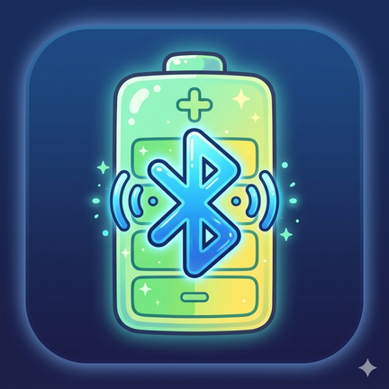

# BT Battery Log

BT Battery Log is an Android utility for monitoring Bluetooth headset battery and showing **local-only** notifications.

No `ntfy`, no server, no internet setup.

## App Icon



## Features

- Reads battery updates from Bluetooth broadcasts / headset vendor events when Android exposes them.
- Focuses on headphone-style Bluetooth audio devices.
- Uses one stable notification ID for battery state.
- Uses adaptive launcher icon artwork based on a Gemini AI-generated Bluetooth battery image.

### Connected state

- While a supported headset is connected and battery is known:
  - shows an ongoing battery notification
  - updates the same notification in place when battery changes

### Disconnected state

- After disconnect (with configured delay), the same notification is converted into a dismissible summary:
  - `Device disconnected at XX% — HH:mm`
- Summary stays until user swipes it away.
- Duplicate disconnect summaries are suppressed.

### Shokz OpenFit left/right/case (experimental, opt-in)

For Shokz OpenFit headsets the app can also read each earbud and the charging case over the
headset's vendor Bluetooth channel. Turn on **Shokz OpenFit left/right/case** in settings (off by
default). Then:

- connected notification: `OpenFit 2+ by Shokz — 90% / 60%` (lower earbud / case)
- disconnect summary: `OpenFit 2+ by Shokz disconnected at L 90% · R 100% · Case 60%`
- status card: left, right and case with the read time, or `Last known: …` when not connected
- unknown values are shown as `—`, never 0%

Close the official Shokz app first: the headset allows one vendor client at a time, and a read while
the Shokz app is connected fails and disconnects that app. The app reads once a few seconds after
connecting and at most every 30 minutes after that; after a failed read it stops until the headset
reconnects. Details: [docs/shokz-openfit.md](docs/shokz-openfit.md). Protocol ported from
[shokz-openfit-battery-sdk](https://github.com/YentlHendrickx/shokz-openfit-battery-sdk) (MIT), see
[THIRD_PARTY_NOTICES.md](THIRD_PARTY_NOTICES.md).

## Notification persistence behavior

- App uses a foreground service while headset is connected to make connected-state notification behavior as persistent as Android allows.
- On disconnect summary, service is stopped and summary notification remains normal/dismissible.

## UI

- Monitoring on/off
- Disconnect delay seconds
- Shokz OpenFit left/right/case (opt-in)
- Refresh now
- Clear activity + debug logs
- Activity feed (compact, user-facing lifecycle events)
- Expandable detailed debug log (`Show debug log` / `Hide debug log`)

## Activity feed format

Main feed shows normalized rows like:

`YYYY-MM-DD HH:mm Device Name XX% (connected|updated|disconnected|notification dismissed)`

Internal diagnostic messages are kept in detailed debug log, not in main feed.

## Permissions

- `android.permission.BLUETOOTH_CONNECT`
- `android.permission.BLUETOOTH` and `android.permission.BLUETOOTH_ADMIN` (`maxSdkVersion="30"`)
- `android.permission.POST_NOTIFICATIONS`
- `android.permission.RECEIVE_BOOT_COMPLETED`
- `android.permission.FOREGROUND_SERVICE`
- `android.permission.FOREGROUND_SERVICE_CONNECTED_DEVICE`

## Build

```bash
./gradlew assembleDebug
```

## Install

```bash
./gradlew installDebug
```

## Known limitations

- Bluetooth battery visibility depends on headset + phone + Android implementation.
- Some devices do not expose battery to third-party apps at all.
- Disconnect detection is best-effort and depends on Bluetooth broadcast/profile behavior.
- On newer Android versions (notably Android 14+), users may still dismiss ongoing notifications in some system flows; app attempts to restore connected notification while connection remains active.
- If app is force-stopped from system settings, future Bluetooth broadcasts may not be delivered until app is opened again.
